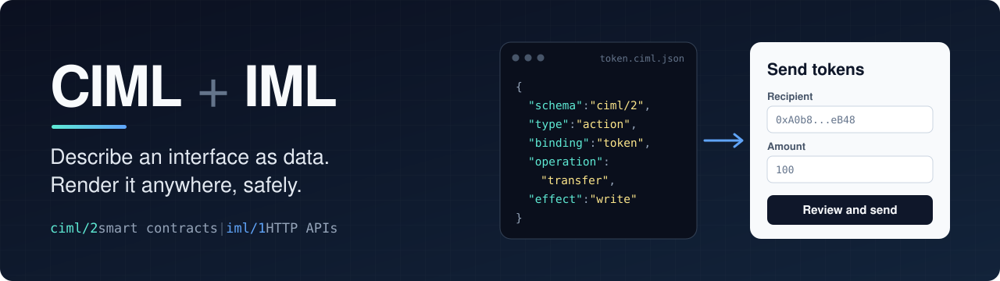
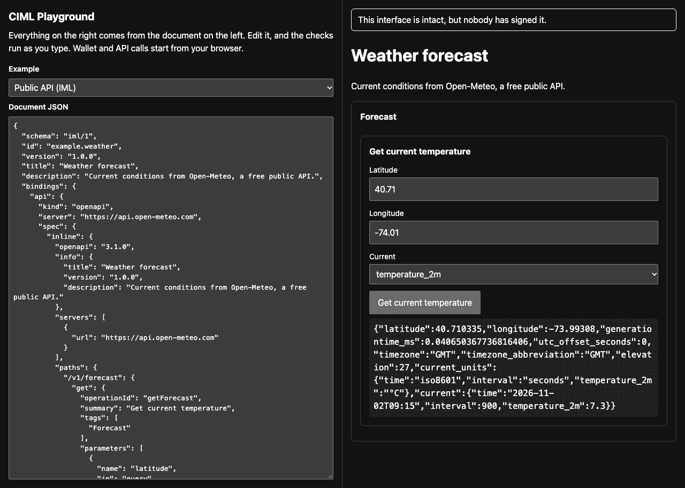
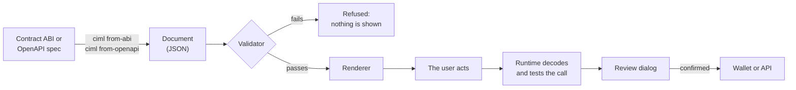
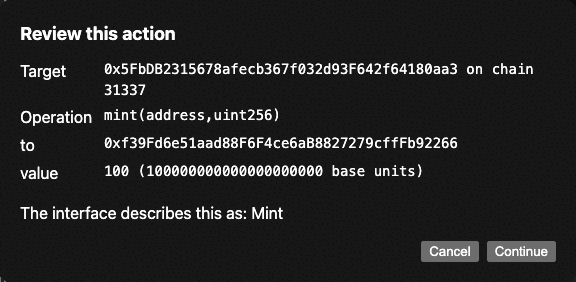
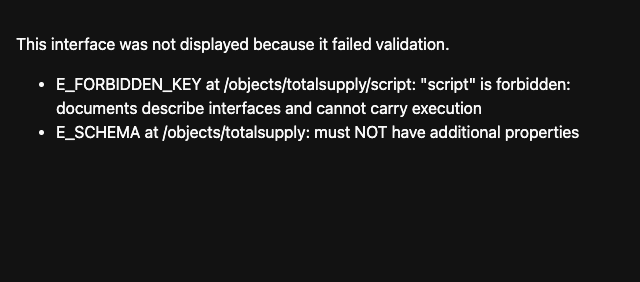

<div align="center">



# CIML and IML

**Describe an interface as data. Render it anywhere, safely.**

<a href="https://github.com/CoinClubQuincy/Contract_Interface_Model_Language/actions/workflows/ci.yml"></a>
<a href="LICENSE"></a>


[Try it](#try-it) · [See it work](#see-it-work) · [Generate a document](#generate-a-document) · [Specification](spec/model.md) · [Security](SECURITY.md) · [Roadmap](ROADMAP.md)

</div>

A CIML or IML document is a JSON file that says what an interface is for: its screens, fields, values and actions, and what each action calls. It holds no code. A renderer turns it into a working interface, and a runtime checks and performs each call.

<table>
<tr>
<th width="50%">CIML, Contract Interface Model Language</th>
<th width="50%">IML, Interface Model Language</th>
</tr>
<tr>
<td>Interfaces for <b>EVM smart contracts</b>, bound through their ABI.<br><br>Schema <code>ciml/2</code><br>Runtime <code>@ciml/evm</code></td>
<td>Interfaces for <b>HTTP APIs</b>, bound through their OpenAPI spec.<br><br>Schema <code>iml/1</code><br>Runtime <code>@ciml/openapi</code></td>
</tr>
</table>

Both share one model, one validator and one renderer.

> [!IMPORTANT]
> **Status: v2 is unreleased and has had no independent security audit.** The packages are not on npm yet, so install from source. Do not put real funds behind it until you have reviewed it yourself. See [SECURITY.md](SECURITY.md).

<p align="center">
  
  <br>
  <sub>The playground, calling a live public weather API. Everything on the right comes from the document on the left.</sub>
</p>

## Why

A contract's ABI says what can be called, not what it means. So every project writes a custom front end, and users have to trust whichever site they landed on.

A document separates the two. It can be generated, reviewed, hashed and signed, and any compatible app can show it. Because it holds no code, a hostile document has far less to work with than a hostile web page:

| Protection | What it means |
|---|---|
| **Nothing to execute** | Scripts and markup are refused, and all text is shown as plain text. |
| **Checked against the real interface** | Every call is compared with the ABI or OpenAPI spec. A document cannot call a function that does not exist, or describe a state-changing call as a read. |
| **The review shows what will really happen** | Before anything changes state, the runtime decodes the call and tests it. The document's own description appears separately, as a claim. |
| **No keys** | CIML uses the wallet you already have, through EIP-1193 and EIP-6963. It never asks a wallet to sign raw data. |

## How it works



## See it work

<table>
<tr>
<td width="50%"></td>
<td width="50%"></td>
</tr>
<tr>
<td><b>Review before signing.</b> The decoded call comes from the runtime. The document's words are shown only as what "the interface describes this as".</td>
<td><b>Refuse, don't render.</b> A document carrying a <code>script</code> key is not displayed at all, and the reason is shown instead.</td>
</tr>
</table>

## Try it

You need Node 20 or later and [pnpm](https://pnpm.io) 9. [Foundry](https://getfoundry.sh) is optional, and enables the tests that run against a real local chain.

```bash
git clone https://github.com/CoinClubQuincy/Contract_Interface_Model_Language.git
cd Contract_Interface_Model_Language
pnpm install
pnpm build
pnpm test
pnpm --filter ciml-playground dev   # Then open the printed URL.
```

The playground puts a document beside its rendered interface, and the checks run as you type. Its API example calls a real public weather service from your browser.

## Generate a document

```bash
alias ciml="node $PWD/packages/cli/dist/cli.js"

# From a contract ABI, or a compiler artifact that contains one
ciml from-abi Token.json --chain-id 50 --address 0xYourContract \
  --id my.token --title "My Token" --token-decimals 18 -o token.ciml.json

# From an OpenAPI 3.x spec
ciml from-openapi openapi.json --id my.api -o api.iml.json

ciml validate token.ciml.json
ciml digest token.ciml.json --write   # Seal the content
ciml verify token.ciml.json           # Report what can be proven
```

Generated documents are a safe starting point. Edit them to suit your users.

### All commands

| Command | What it does |
|---|---|
| `ciml validate <file>` | Runs every check. `--fetch-specs` also fetches remote OpenAPI specs and checks their pinned digests. |
| `ciml digest <file>` | Prints the digest. `--write` stores it in the file. |
| `ciml verify <file>` | Reports digest, signature and code hash results. `--rpc <chainId>=<url>` enables on-chain checks. |
| `ciml from-abi <file>` | Generates a CIML document. |
| `ciml from-openapi <file>` | Generates an IML document, and lists any operations it left out. |
| `ciml migrate <file>` | Converts a CIML v1 document, and lists everything that did not carry over. |
| `ciml to-7730 <file>` | Exports an [ERC-7730](https://ercs.ethereum.org/ERCS/erc-7730) descriptor, so wallets can show the same intent. |
| `ciml attach-signature <file>` | Adds an EIP-191 or ERC-1271 signature over the digest. |

Exit codes: `0` success, `1` the document failed, `2` bad usage.

## Render a document

```tsx
import { discoverWallets, EvmRuntime, validateCiml, verifyCiml } from "@ciml/evm";
import { CimlRenderer } from "@ciml/react";
import "@ciml/react/styles.css";

const [wallet] = await discoverWallets(window);
const runtime = new EvmRuntime({ document, provider: wallet?.provider });
const report = await verifyCiml(document);

<CimlRenderer
  document={document}
  runtime={runtime}
  validate={validateCiml}
  trust={{ level: report.level, signers: report.signatures.filter((s) => s.valid).map((s) => s.signer) }}
/>;
```

For an API, use `ApiRuntime` and `validateIml` from `@ciml/openapi`. Give `ApiRuntime` a `token` provider if the API needs sign-in.

## A document

A complete document for sending a token. Other documents, including an API and an XDC treasury, are in [`examples/documents`](examples/documents).

<details>
<summary><b>Show the JSON</b></summary>

```json
{
  "schema": "ciml/2",
  "id": "example.token",
  "version": "1.0.0",
  "title": "My Token",
  "bindings": {
    "token": {
      "kind": "evm",
      "chainId": 50,
      "address": "0xA0b86991c6218b36c1d19D4a2e9Eb0cE3606eB48",
      "abi": [
        { "type": "function", "name": "transfer", "stateMutability": "nonpayable",
          "inputs": [{ "name": "to", "type": "address" }, { "name": "amount", "type": "uint256" }],
          "outputs": [{ "name": "", "type": "bool" }] }
      ]
    }
  },
  "root": "send",
  "objects": {
    "send": {
      "type": "form",
      "purpose": "Send tokens to someone",
      "accessibility": { "label": "Send" },
      "children": ["send.to", "send.amount", "send.go"]
    },
    "send.to": {
      "type": "field",
      "purpose": "Who receives the tokens",
      "accessibility": { "label": "Recipient" },
      "field": { "name": "to", "inputType": "address", "required": true }
    },
    "send.amount": {
      "type": "field",
      "purpose": "How many tokens to send",
      "accessibility": { "label": "Amount" },
      "field": { "name": "amount", "inputType": "amount", "decimals": 18, "required": true }
    },
    "send.go": {
      "type": "action",
      "purpose": "Send the transaction",
      "accessibility": { "label": "Send" },
      "action": {
        "binding": "token",
        "operation": "transfer",
        "effect": "write",
        "inputs": { "to": { "field": "send.to" }, "amount": { "field": "send.amount" } },
        "confirm": { "title": "Send tokens" }
      }
    }
  }
}
```

</details>

## Repository

| Path | Contents |
|---|---|
| [`spec/`](spec) | The format: [model](spec/model.md), [CIML](spec/ciml.md), [IML](spec/iml.md), [security](spec/security.md), JSON Schema |
| `packages/core` | `@ciml/core`: model, validator, digest |
| `packages/ciml` | `@ciml/evm`: ABI checks, verification, wallet runtime, generator, ERC-7730 export, v1 migration |
| `packages/iml` | `@ciml/openapi`: OpenAPI checks, hardened API client, generator |
| `packages/react` | `@ciml/react`: renderer, review dialog, trust banner |
| `packages/cli` | `@ciml/cli`: the `ciml` command |
| [`conformance/`](conformance) | Language-neutral test vectors, for building another implementation |
| `examples/` | Documents, test contracts, playground |
| [`legacy/`](legacy) | CIML v1, archived. **Do not use with real funds.** |

## How it has been tested

| Check | Result | Where it runs |
|---|---|---|
| Unit and integration tests | **363 passing**, including 12 against a real local chain (Anvil and Forge) | CI |
| Conformance vectors | **47 invalid and 8 valid documents**, plus canonical digest vectors, for checking any implementation | CI |
| Mutation test | **49 of 49** deliberately broken safety checks were caught by the tests | One-off, before this release |
| Real browser, API | Live weather call in headless Chrome, sent only to the server the document names | One-off, before this release |
| Real browser, contract | A test wallet to a local chain: cancelling sends nothing, confirming sends one transaction and the chain agrees, a wrong network is blocked | One-off, before this release |

**Not yet tested:** a real wallet such as MetaMask, a real testnet or mainnet transaction, and an independent security audit.

## Limits today

- EVM only for contracts, and the web only for rendering. See the [roadmap](ROADMAP.md).
- A valid signature proves who signed a document, not that the signer or the contract is honest.
- The ERC-7730 export is checked against the published schema. It has not been tried on a real wallet or hardware device, and ERC-7730 is still a draft.
- The validator compiles its schema at runtime, so a page using it needs `script-src 'unsafe-eval'` in its Content Security Policy. A precompiled validator is on the roadmap.

More limits, and what each protection does and does not cover, are in [spec/security.md](spec/security.md).

## Contributing

See [CONTRIBUTING.md](CONTRIBUTING.md). Report security problems privately, as described in [SECURITY.md](SECURITY.md).

## License

[MIT](LICENSE)
